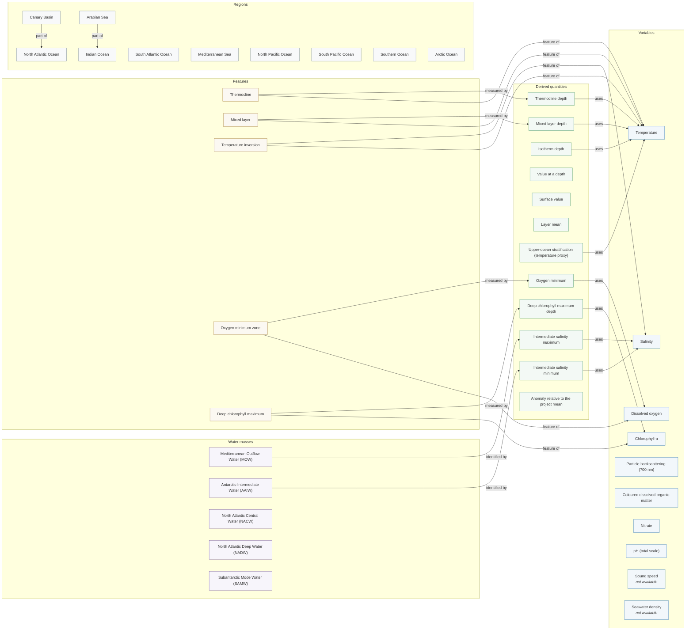

# OceoGeo ontology — concept graph

_Generated by `OceoGeoAPI/core/ontology_export.py` from `OceoGeoAPI/ontology/*.yaml`. Do not edit by hand._

45 concepts. Pressure and the time/position coordinates are omitted from the diagram because almost everything uses them; water-mass → region (`found in`) links are listed in the tables below.

## Concepts

### Variables

| Concept | Aliases (sample) | Definition | Standard |
|---|---|---|---|
| **Chlorophyll-a** (`chla`) | chlorophyll, chlorophyll-a, chla, CHLA | Chlorophyll-a concentration, a proxy for phytoplankton biomass. | mass_concentration_of_chlorophyll_a_in_sea_water |
| **Coloured dissolved organic matter** (`cdom`) | cdom, CDOM, coloured dissolved organic matter, colored dissolved organic matter | Fluorescence of coloured dissolved organic matter. | CDOM |
| **Dissolved oxygen** (`doxy`) | oxygen, dissolved oxygen, doxy, DOXY | Dissolved oxygen concentration; reflects air-sea exchange, photosynthesis, respiration and how long ago water left the surface. | moles_of_oxygen_per_unit_mass_in_sea_water |
| **Nitrate** (`nitrate`) | nitrate, NITRATE, no3, NO3 | Nitrate concentration, a major nutrient for phytoplankton growth that also traces remineralisation and water-mass history. | moles_of_nitrate_per_unit_mass_in_sea_water |
| **Particle backscattering (700 nm)** (`bbp700`) | backscatter, backscattering, bbp, bbp700 | Optical backscattering by particles; a proxy for particulate organic carbon. | BBP700 |
| **Pressure (depth)** (`pressure`) | pressure, depth, dbar, deep | Sea water pressure; 1 dbar is approximately 1 m of depth, so pressure is used as the depth coordinate. depth_level is an array index, not… | sea_water_pressure |
| **Salinity** (`salinity`) | salinity, salt, saltiness, psal | Practical salinity (dissolved salt content). Set at the surface by evaporation minus precipitation, and at depth by water-mass mixing. | sea_water_practical_salinity |
| **Seawater density** (`density`) | density, potential density, sigma, sigma0 | **Not available yet.** Seawater density, which controls stratification and the depth water sinks to. |  |
| **Sound speed** (`sound_velocity`) | sound velocity, sound speed, speed of sound, sofar | **Not available yet.** Speed of sound in seawater, a function of temperature, salinity and pressure; typically 1450–1550 m/s. Its minimum near ~1000 m forms the… |  |
| **Temperature** (`temperature`) | temperature, temp, sea temperature, water temperature | In-situ sea water temperature. With salinity it sets seawater density and therefore stratification. | sea_water_temperature |
| **pH (total scale)** (`ph`) | ph, pH, acidity, acidification | Seawater acidity, part of the marine carbonate system and the ocean acidification signal. | sea_water_ph_reported_on_total_scale |

### Coordinates

| Concept | Aliases (sample) | Definition | Standard |
|---|---|---|---|
| **Position** (`position`) | position, location, locations, where has | Profile position (one per profile). Use the map chart to show it. |  |
| **Time** (`time`) | time, date, when, over time | Profile time. Order and plot by observed_at; cycle_number repeats across floats and is not a time axis. |  |

### Derived quantities

| Concept | Aliases (sample) | Definition | Standard |
|---|---|---|---|
| **Anomaly relative to the project mean** (`depth_anomaly`) | anomaly, anomalies, deviation, compared to average | How much each profile differs from the project's mean profile at the same depth. |  |
| **Deep chlorophyll maximum depth** (`chlorophyll_maximum_depth`) | chlorophyll maximum, chlorophyll max, dcm depth, depth of chlorophyll maximum | Depth of the highest chlorophyll-a value in each profile. |  |
| **Intermediate salinity maximum** (`intermediate_salinity_maximum`) | salinity maximum, salinity max, salty layer, saltiest layer | A subsurface local maximum of salinity in the intermediate layer — the classic signature of Mediterranean Outflow Water in the North Atla… |  |
| **Intermediate salinity minimum** (`intermediate_salinity_minimum`) | salinity minimum, salinity min, fresh layer, freshest layer | A subsurface local minimum of salinity at intermediate depth — the signature of Antarctic Intermediate Water. |  |
| **Isotherm depth** (`isotherm_depth`) | isotherm, isotherm depth, isotherms | Depth at which water first reaches a given temperature. |  |
| **Layer mean** (`layer_mean`) | layer mean, layer average, average between, mean between | Mean of a variable over a depth layer, per profile. |  |
| **Mixed layer depth** (`mixed_layer_depth`) | mixed layer depth, mld, MLD, surface mixed layer depth | Depth of the near-surface layer homogenised by wind and convection. |  |
| **Oxygen minimum** (`oxygen_minimum`) | oxygen minimum, lowest oxygen, minimum oxygen, oxygen min | Depth and value of the lowest dissolved oxygen in each profile. |  |
| **Surface value** (`surface_value`) | surface, surface value, sea surface, near-surface | The shallowest valid measurement of a variable in each profile. |  |
| **Thermocline depth** (`thermocline_depth`) | thermocline depth, temperature gradient, steepest temperature drop | Depth where temperature decreases most rapidly with depth. |  |
| **Upper-ocean stratification (temperature proxy)** (`stratification_index`) | stratification, stratified, stability, water column stability | How strongly the upper ocean is layered. |  |
| **Value at a depth** (`value_at_depth`) | at depth, at a depth, value at depth, at a given depth | A variable's value at (closest to) a requested depth in each profile. |  |

### Features

| Concept | Aliases (sample) | Definition | Standard |
|---|---|---|---|
| **Deep chlorophyll maximum** (`deep_chlorophyll_maximum`) | deep chlorophyll maximum, dcm, DCM, subsurface chlorophyll maximum | A subsurface peak in chlorophyll, typical of stratified, nutrient-poor waters where phytoplankton grow near the nutricline. |  |
| **Mixed layer** (`mixed_layer`) | mixed layer | The well-mixed surface layer of nearly uniform temperature and salinity. |  |
| **Oxygen minimum zone** (`oxygen_minimum_zone`) | oxygen minimum zone, omz, OMZ, hypoxic | A subsurface layer of strongly depleted oxygen, typically 200–1000 m in the eastern tropical Pacific, Arabian Sea and Bay of Bengal. |  |
| **Temperature inversion** (`temperature_inversion`) | temperature inversion, inversion, inversions, warmer below | Temperature increasing with depth over some interval. Stable only when the deeper water is saltier; common below the mixed layer near fro… |  |
| **Thermocline** (`thermocline`) | thermocline | The layer where temperature drops rapidly with depth, separating warm surface water from cold deep water. |  |

### Water masses

| Concept | Aliases (sample) | Definition | Standard |
|---|---|---|---|
| **Antarctic Intermediate Water (AAIW)** (`antarctic_intermediate_water`) | antarctic intermediate water, aaiw, AAIW, intermediate water | Cool, fresh intermediate water formed near the Subantarctic Front; a local salinity minimum at ~700–1000 dbar. Fresh (34.2–34.5) in the s… | 500–1300 dbar; found in Southern Ocean, South Atlantic Ocean, Indian Ocean, South Pacific Ocean, North Atlantic Ocean |
| **Mediterranean Outflow Water (MOW)** (`mediterranean_outflow_water`) | mediterranean outflow water, mediterranean water, mow, MOW | Warm, salty intermediate water from the Strait of Gibraltar spreading into the eastern North Atlantic at ~1000 m. Shows as a local salini… | 600–1600 dbar; found in North Atlantic Ocean |
| **North Atlantic Central Water (NACW)** (`north_atlantic_central_water`) | north atlantic central water, central water, nacw, NACW | The thermocline water of the subtropical North Atlantic: an almost linear temperature–salinity relation between ~8 °C/35.0 and ~19 °C/36.… | 100–700 dbar; found in North Atlantic Ocean |
| **North Atlantic Deep Water (NADW)** (`north_atlantic_deep_water`) | north atlantic deep water, nadw, NADW, deep water | Cold, relatively salty deep water formed in the Nordic and Labrador Seas. Core Argo floats (2000 dbar) only sample its upper part. | 1500–4000 dbar; found in North Atlantic Ocean, South Atlantic Ocean |
| **Subantarctic Mode Water (SAMW)** (`subantarctic_mode_water`) | subantarctic mode water, samw, SAMW, mode water | A thick, weakly stratified layer formed by deep winter mixing just north of the Subantarctic Front; shows as a thermostad (small vertical… | 200–700 dbar; found in Southern Ocean, Indian Ocean, South Pacific Ocean, South Atlantic Ocean |

### Regions

| Concept | Aliases (sample) | Definition | Standard |
|---|---|---|---|
| **Arabian Sea** (`arabian_sea`) | arabian sea |  | lat [0, 25], lon [[50, 78]] |
| **Arctic Ocean** (`arctic_ocean`) | arctic ocean, arctic, polar north, high arctic |  | lat [66.5, 90], lon [[-180, 180]] |
| **Canary Basin** (`canary_basin`) | canary basin, canary, canaries, canary current |  | lat [20, 36], lon [[-30, -10]] |
| **Indian Ocean** (`indian_ocean`) | indian ocean |  | lat [-60, 30], lon [[20, 120]] |
| **Mediterranean Sea** (`mediterranean_sea`) | mediterranean sea, the mediterranean, med sea |  | lat [30, 46], lon [[-6, 36]] |
| **North Atlantic Ocean** (`north_atlantic`) | north atlantic, n atlantic, northern atlantic |  | lat [0, 66], lon [[-80, 0]] |
| **North Pacific Ocean** (`north_pacific`) | north pacific, n pacific |  | lat [0, 66], lon [[120, 180], [-180, -100]] |
| **South Atlantic Ocean** (`south_atlantic`) | south atlantic, s atlantic, southern atlantic |  | lat [-60, 0], lon [[-70, 20]] |
| **South Pacific Ocean** (`south_pacific`) | south pacific, s pacific |  | lat [-60, 0], lon [[150, 180], [-180, -70]] |
| **Southern Ocean** (`southern_ocean`) | southern ocean, antarctic, antarctica, antarctic ocean |  | lat [-90, -60], lon [[-180, 180]] |

